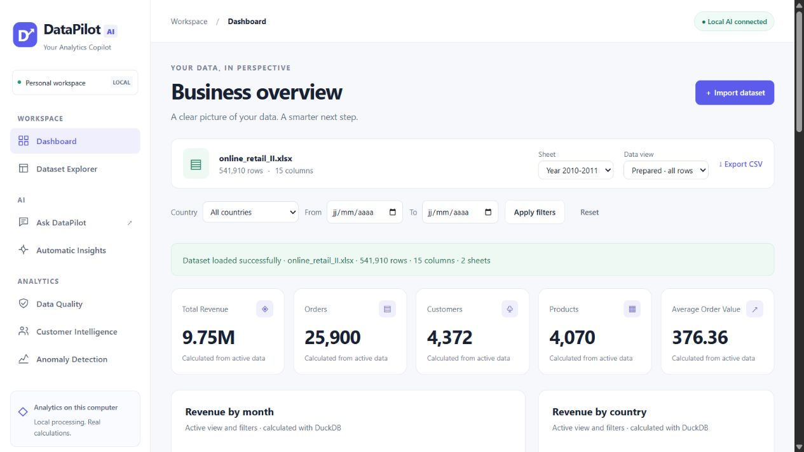

# DataPilot AI

**Your Analytics Copilot**
Conversational AI Agent for Business Data Analytics

Upload a CSV or Excel workbook, explore it visually, ask natural-language questions, inspect the SQL, and turn calculated findings into decisions. DataPilot combines DuckDB analytics with optional local or hosted AI. Numerical answers are rendered from actual results, never invented by a language model.

The existing **separate HTML/CSS/JavaScript frontend and Python services** are preserved. There is no frontend build step, JavaScript CDN, or Streamlit runtime. Streamlit-specific directions in the original brief are implemented through equivalent web interface components, following the explicit interface choice.



## Run locally

Use your existing activated Python environment:

```sh
python app.py
```

Open `http://127.0.0.1:8501`. Windows users can also run `./launch.ps1`; it finds the existing project or sibling virtual environment without installing anything. `python app.py --port 8503` selects another port.

For **a new checkout only**, use Python 3.11+ and install `requirements.txt` in your chosen environment. This upgrade reused the existing environment and installed only the missing Waitress server. Nothing is installed automatically at startup.

Optional configuration:

```sh
# Copy .env.example to .env and edit values, then:
python app.py --env-file .env
```

The environment-file reader accepts `KEY=value` and quoted values; it does not execute shell code, expand variables, or override values already set by the shell/hosting platform.

## Workspace

| Page | What you can do |
|---|---|
| Dashboard | Inspect adaptive KPIs, revenue over time, countries, products, customers and purchasing patterns. Apply country/date filters or open Ask DataPilot. |
| Dataset Explorer | Switch Overview, Columns, Statistics and Preview; search columns; inspect missing percentages, cardinality, full-column distributions and date ranges; build charts or use the advanced SQL workspace. |
| Ask DataPilot | Ask questions with schema-aware suggestions; inspect calculated findings, tables, charts, SQL and execution details; follow up or revisit session history. |
| Data Quality | Review a documented quality score, affected-row rates, examples, type conversions and IQR signals; preview a cleaning policy and explicitly apply it to a separate copy. |
| Automatic Insights | Generate an executive briefing and categorized findings with supporting SQL/data. Optionally let AI prioritize verified facts. |
| Customer Intelligence | Calculate RFM, scaled KMeans groups, distribution/revenue charts, customer profiles and label rationale; export all segment memberships or chat about them. |
| Anomaly Detection | Inspect Isolation Forest scores, anomaly rate/distribution, unusual transactions and feature comparisons against the scored population. |

The shared interface includes responsive navigation, consistent Plotly styling, removable filter chips, active dataset/view/sheet controls, CSV exports, loading/error states and accurate local/cloud provider status. No account, payment, subscription or security certification is claimed.

## Data and cleaning

CSV, XLSX and legacy XLS are supported. Workbook sheets can be selected without re-uploading. File data is retained in the session; repeated analyses and reference workbook loads are cached. The default upload cap is 100 MB. Previews and SQL result displays are bounded; analytical aggregates use the full active view.

- **Original raw data:** original loaded values and column names.
- **Prepared:** a separate copy with safe type conversions and derived fields; every source row remains.
- **Cleaned:** a separate copy based on an explicitly chosen policy, previewed before application in the UI.

For retail data, `Invoice` → `InvoiceNo`, `Price` → `UnitPrice`, and `Customer ID` → `CustomerID` where needed. Preparation calculates `Revenue = Quantity * UnitPrice`, Year, Month, Day, Hour, DayOfWeek and IsCancelled. Invoice identifiers starting with C indicate cancellation. Invalid conversions become missing only in the copy. Generic files retain their schema and can use explicit conversion controls. Retail-only features explain missing prerequisites.

Default cleaning removes duplicate rows; all other row removal and imputation choices are opt-in. Missing numeric values are kept by default. Preview tokens expire after data/view/filter changes, and an applied preview cannot be reused. Valid country/date filters survive cleaning. Uploading a different file or sheet resets dependent filters and analyses. Data, view and filter changes clear chat to prevent stale numerical context.

Revenue is signed, so returns/cancellations affect totals unless removed. Orders count distinct nonmissing invoice IDs, including cancellation IDs if retained. Average order value averages invoice-level revenue. No currency symbol is assumed. Mixed currencies, fiscal calendars and business return policies require explicit domain interpretation.

Best-selling products ranks net units (`SUM(Quantity)`) using Description when available, otherwise StockCode. Highest-revenue products ranks `SUM(Revenue)` instead. Missing ranking identifiers are excluded. These definitions also apply to the standard chat tools.

The quality score is **100 × mean(completeness, row uniqueness, conversion validity)**. Completeness measures nonmissing original cells, uniqueness measures rows excluding repeat duplicates, and validity measures original cells that do not fail preparation conversions. The UI gives the exact denominators. Cancellations, nonpositive values and IQR outliers are separate review signals rather than automatic score penalties.

## Reference dataset

The local development workbook is **UCI Online Retail II**, with `Year 2009-2010` and `Year 2010-2011` sheets. It differs from the single-year Online Retail dataset mentioned in the original PDF. The application detects whether the workbook is installed and offers the reference action only when available. Uploads work without it.

Large workbooks, private uploads and generated exports are excluded from Git and Docker. To use the reference shortcut on another host, place an appropriately licensed workbook at `data/raw/online_retail_II.xlsx`. The first Excel read is slower; later reference loads use a local Parquet cache. The original workbook is never overwritten.

Attribution: [UCI Online Retail II](https://doi.org/10.24432/C5CG6D). Alternative reference: [UCI Online Retail](https://doi.org/10.24432/C5BW33). Check the dataset's license before redistribution. The exploration notebook and historical local verification reports describe the actual supplied workbook, not fixed values used by the app.

## Local and remote AI

Local defaults:

```text
LLM_PROVIDER=ollama
OLLAMA_BASE_URL=http://127.0.0.1:11434
OLLAMA_MODEL=qwen3:4b
```

Start your existing Ollama service. If the model is missing, run `ollama pull qwen3:4b` on the Ollama host. DataPilot never installs Ollama or downloads models. `OLLAMA_HOST` remains a compatibility alias for the base URL.

Hosted configuration:

```text
APP_MODE=cloud
HOST=0.0.0.0
PORT=8501
PUBLIC_URL=https://your-actual-hostname
LLM_PROVIDER=remote
REMOTE_LLM_BASE_URL=https://your-provider.example/v1
REMOTE_LLM_MODEL=your-model-id
REMOTE_LLM_API_KEY=set-in-host-secret-manager
REMOTE_LLM_FORMAT=json_object
```

The remote adapter uses the chat-completions HTTP protocol (`GET /models`, `POST /chat/completions`) with bearer authentication and JSON output. A compatible hosted provider such as Groq can be configured; no OpenAI SDK or OpenAI service is required. The base URL includes the provider API prefix, for example Groq's documented `https://api.groq.com/openai/v1`. Choose an available model that supports JSON mode. `json_schema` is optional for compatible endpoints; Pydantic always validates output locally.

Remote endpoints require HTTPS except loopback test servers. The key remains server-side and is excluded from public metadata, exceptions and logs. AI receives questions, schema, bounded conversation/result summaries and selected calculated facts, not full datasets. Configure providers according to your data-handling requirements. There is **no automatic cross-provider fallback**. Missing keys, unavailable models or connection failures leave non-AI analytics working. `LLM_PROVIDER=disabled` explicitly disables language-model requests.

Provider health reports model-list availability, not a guarantee that every future generation will succeed. The status dialog can recheck the connection.

## Grounded chat and SQL

Question → intent/tool → real schema and bounded history → Pydantic plan → SQL validation → DuckDB → actual result → findings, table and chart.

The planner supports SQL, dataset information, statistics, quality, charts, insights, segmentation, anomalies and clarification. It has one initial attempt and at most two corrections, including invalid JSON and execution errors. Deterministic Python handles calculations. The model can select existing insight facts by index; it cannot rewrite their numbers. Missing information produces a clarification rather than a numerical guess.

Try: “What are the top 5 countries by revenue?”, “Exclude the United Kingdom”, “Show only 3”, “Show that as a chart”, “Show revenue by month”, “Compare France and Germany”, or “Which customers are at risk?”. General interpretation requires a configured model. Exact tools such as “Show statistics”, “Generate insights” and monthly revenue also work without one.

A calculation badge appears only after successful execution. Traces report the actual dataset, view, filters, engine, available input size and returned columns/rows. Available rows are not represented as the number that contributed to a particular aggregate. History reopens previous results; follow-ups refer to the latest analysis. Clear Conversation removes session chat.

SQL safeguards:

- One SELECT or WITH ... SELECT statement; sqlparse plus defensive token/function checks.
- Writes, DDL/admin commands, multiple statements, extensions, external readers, catalogs, recursive CTEs and unknown tables are rejected.
- DuckDB external access is disabled; only registered `sales` and optional `segments` are available.
- Manual SQL and model SQL use the same validator, a 15-second interrupt, 512 MB query memory, two threads and a 1,000-row return cap.
- No model output is passed to Python execution, shell execution or eval.

Safe SQL can still be semantically wrong. Review the SQL and metric definitions before acting on an answer. The allowlist deliberately rejects some valid DuckDB expressions.

## Customer and anomaly models

RFM excludes cancellations, missing IDs/dates and nonpositive purchases. Recency uses the day after the latest eligible purchase, frequency counts distinct invoices and monetary value sums positive eligible revenue. KMeans uses `log1p`, StandardScaler, `random_state=42` and `n_init=10`. Group labels come from observed means relative to medians; group zero is not automatically VIP, labels may repeat and some labels may be absent. These are descriptive heuristics, not proven churn forecasts.

Isolation Forest uses available Quantity/UnitPrice/Revenue or generic numeric columns, deterministic sampling and an explicit contamination fraction. Incomplete/nonfinite feature rows are excluded and counted. Higher scores are more unusual; positive scores are flagged. Transaction details compare real feature values to population statistics without claiming these are causal model explanations. **Statistical anomalies do not establish fraud.**

## Architecture

```text
app.py                       Shared request dispatcher and local/hosted launcher
frontend/                    Responsive HTML/CSS/JS; shared ui.js components
pages/                       Framework-independent page presenters
services/config.py           Validated environment and public metadata
services/llm_service.py       Ollama and remote providers; evidence selection
services/wsgi_service.py      Production WSGI adapter for the same API routes
services/                    Loading, cleaning, profiling, SQL, charts, memory
ml/                          RFM, KMeans and Isolation Forest
prompts/                     Schema-grounded planning rules
notebooks/eda.ipynb           Reference exploration
scripts/                     Verification and deliverable tools
tests/                       Unit, HTTP, provider and cloud-mode tests
data/raw/, data/processed/    Local-only data/cache/export locations
Dockerfile, .dockerignore     Portable deployment image; no dataset or secrets
.env.example                 Placeholder configuration
.github/workflows/tests.yml  Linux CI tests and syntax checks
DEPLOYMENT.md                Local, hosted and Docker deployment guide
```

Static assets and Plotly JavaScript are served by the same origin from installed packages. Local mode uses the existing HTTP transport; hosted mode requires Waitress. There is no duplication of analytics routes. Session workspaces and conversation caches are isolated by random HttpOnly SameSite cookies. A configured HTTPS public origin enables Secure cookies. Host/origin checks and same-origin mutation headers remain enforced.

## Deployment and GitHub

See [DEPLOYMENT.md](DEPLOYMENT.md) for a container or Python-hosted deployment. A public visitor only needs a browser; the server runs Python and connects to its configured provider. It does not need the developer's laptop or localhost Ollama.

This repository contains no fake public URL. The code is ready for a configured host; publishing still requires your hosting account/domain and AI credentials if remote chat is desired. Treat this project directory as the repository root; do not publish the surrounding Downloads folder. Private datasets, secrets, caches and generated evidence are excluded. Review staged files before a public push. CI does not require a workbook or AI credentials.

## Verify

```sh
python -m pytest -q
python -m compileall -q app.py services pages ml tests
node --check frontend/app.js
node --check frontend/ui.js
```

Node is only needed for the optional JavaScript syntax check, not to launch the product. `scripts/verify_upgrade.py` runs the current full-workbook/live-Ollama acceptance check against `DATAPILOT_URL`; `scripts/verify_reference.py` retains the original acceptance checks. Both need the reference file and model; regular tests use fixtures and mocks. See the [upgrade implementation and verification report](docs/upgrade_verification.md) for current results. Historical reports are retained separately.

## Operating limits and future work

This is a deployable, single-process demonstration product, not an authenticated multitenant service. Sessions expire after two idle hours by default and disappear on restart. Do not run multiple replicas/workers without shared session storage. Resource limits and idle cleanup bound the number of workspaces, but large uploads/ML jobs still consume memory and threads. Hosts must allow long-running requests and sufficient RAM; cold Excel reads and CPU model generation can take minutes.

No login, access control, durable audit database, persistent user storage, background job queue or billing exists. Use public/sample data for an anonymous demo; use a trusted access-controlled hosting layer for private business data. Deployment must terminate TLS. Uploads can be temporarily buffered by the serving platform, and host storage/log policy is the operator's responsibility. The app logs operation/error types and incident IDs without keys, queries or raw dataset rows.

Potential next work: persistent workspaces, asynchronous jobs, richer schema mapping, identity/access control, data residency controls and larger semantic SQL benchmarks. Saved analyses and natural-language cleaning are not displayed as unsupported controls. No project license is asserted on your behalf; select one before inviting redistribution.
